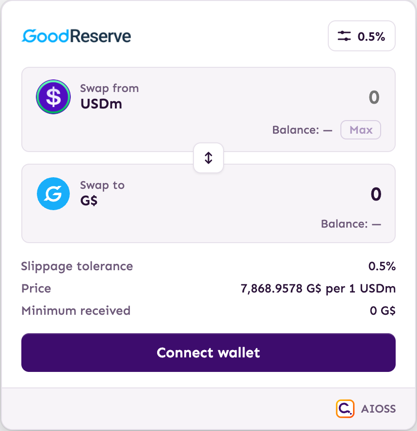
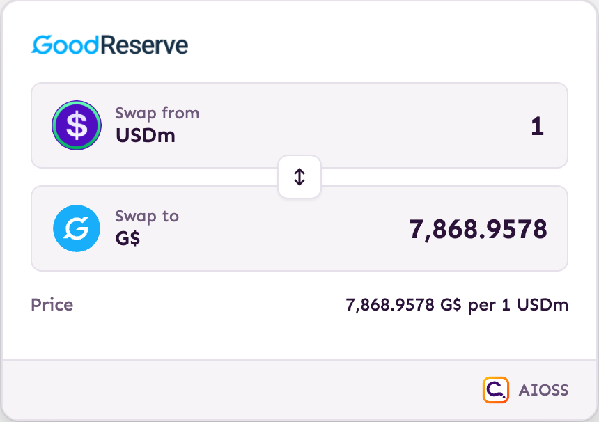

# GoodReserve

Flat React widget for swapping GoodDollar (G$) and USDm through the GoodDollar reserve on Celo mainnet.

**GoodReserve by CNV Labs KO XYZ.**





The widget quotes and prepares swaps with [`@cnvlabskoxyz/celina-sdk/gooddollar-reserve`](https://github.com/andrewkimjoseph/celina-sdk). Wallet connection uses [RainbowKit](https://rainbowkit.com). The host app owns `WagmiProvider` and `RainbowKitProvider`.

```tsx
import { GoodReserveProvider, GoodReserveWidget, flatTheme } from "@cnvlabskoxyz/goodreservekit";

<GoodReserveProvider attributionTags={["your_app"]} theme={flatTheme()}>
  <GoodReserveWidget defaultDirection="buy" />
</GoodReserveProvider>
```

`defaultDirection="buy"` spends USDm to receive G$. `"sell"` spends G$ to receive USDm.

Swap mode checks for an injected wallet that is already connected (`eth_accounts` only, so it never opens a prompt). If one is connected, the widget uses it and skips "Connect wallet". Otherwise the button still opens RainbowKit. Pass `detectInjected={false}` to skip the check. Quote mode does not look for a wallet.

## Quote-only mode

`mode="quote"` is the same widget with the wallet, balance, Max, slippage, and swap controls removed. It does not need a connected wallet, `WagmiProvider`, or `RainbowKitProvider`.

```tsx
<GoodReserveWidget mode="quote" defaultDirection="buy" />
```

The USDm field starts at 1, so a quote shows as soon as the widget loads. Flipping clears it. With `defaultDirection="sell"` the G$ field starts empty. The price line is the reserve quote for 1 USDm, written as G$ per 1 USDm, including before an amount is typed and after the direction flips. Quotes use `https://forno.celo.org`. Pass `rpcUrl` on `GoodReserveProvider` to use another endpoint. `useStandaloneGoodReserveQuote({ amount, direction })` is the headless version, and `GoodReserveWidget.Custom mode="quote"` exposes the same state. Quotes are not attributed. ERC-8021 tags are appended only to approve and swap calldata in swap mode.

## Headless hooks

`useGoodReserveQuote`, `useStandaloneGoodReserveQuote`, `usePrepareGoodReserveSwap`, and `useGoodReserveSwap` are exported for custom UI. `GoodReserveWidget.Custom` is a render prop with the same state the built-in widget uses. Swap hooks still need `WagmiProvider`.

## Theme

`flatTheme()` is the default: a white card, 1px borders, a soft shadow, and CNV Labs purple on the primary button. Override with `mergeTheme(flatTheme(), { colors: { primary: "#ff00aa" } })`. Tokens are CSS variables prefixed `--grk-` on the widget root.

## Demo

```bash
npm install
npm run dev
```

Set `VITE_WALLETCONNECT_PROJECT_ID` in `examples/demo/.env` if you want WalletConnect. Injected wallets work without it.

## Scope

Celo mainnet only. The pair is G$ ↔ USDm only. Slippage is enforced on-chain via `amountOutMin`. There is no transaction-deadline field, because the reserve `swapIn` call does not take one.
